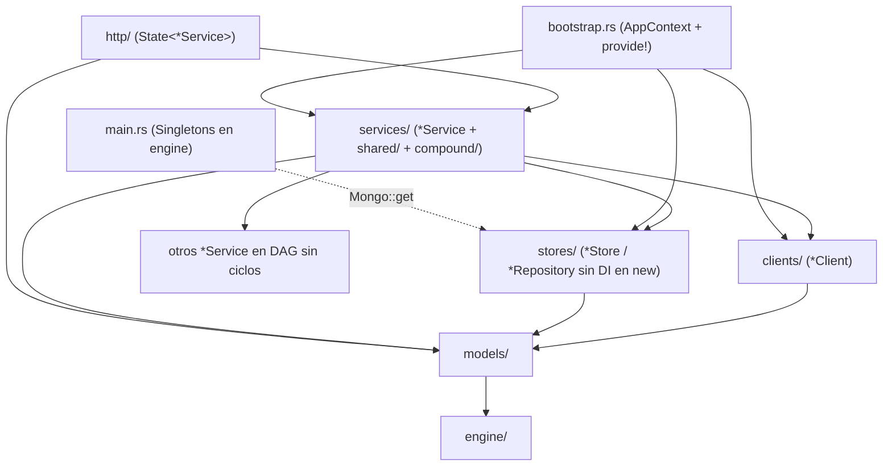
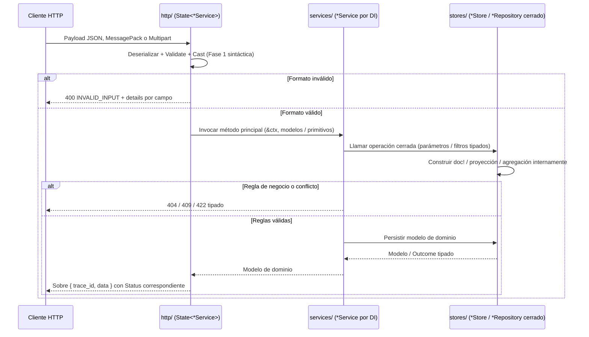

## 1. Arquitectura del Workspace y Fronteras

Mantendré el proyecto dividido en dos crates dentro del Virtual Workspace: `engine/` concentra el motor técnico reutilizable y permanecerá intacto durante el desarrollo de funcionalidades salvo solicitud explícita para extender el framework, mientras que `service/` aloja todo el código del microservicio. Trataré los dominios `users`, `orders`, `checkout` y `carrier` presentes en `service/` como implementaciones de referencia del molde arquitectónico que pueden sustituirse al iniciar un servicio nuevo respetando las mismas fronteras.

En `service/src/` modelaré cada dominio como un archivo plano por defecto, permitiendo estructuras auxiliares adicionales dentro de `stores/` y `services/`, subcarpetas organizativas (`services/shared/`, `services/compound/`) y la expansión a `<dominio>/mod.rs` con submódulos cohesivos cuando un dominio agrupe múltiples sub-flujos extensos:

```text
service/src/
├── main.rs                    # Arranque: engine::boot, Envs, Telemetry, singletons y ServerLauncher
├── bootstrap.rs               # Ensamblaje DI de *Service + engine::provide!(AppContext => ...)
├── envs.rs                    # Catálogo tipado Env (FromEnv) + acceso global envs::get()
├── routes.rs                  # Prefijos versionados (/api/v1) y middlewares de reino (Auth / headers)
├── models/
│   ├── mod.rs                 # Reexporta modelos e identidades públicas
│   ├── shared.rs              # Objetos de valor transversales (Money, Currency, Country, Kilograms)
│   └── <singular>.rs          # Struct del modelo + alias *Id + constructores e invariantes
├── stores/                    # Condicional: solo para dominios con persistencia propia
│   ├── mod.rs                 # Reexporta *Store / *Repository y tipos auxiliares
│   ├── helpers.rs             # Helpers de persistencia propios del servicio (paginate, primary_collection)
│   └── <dominio>.rs           # Struct *Store o *Repository (Mongo::get en new, sin DI) + filtros/outcomes
├── clients/                   # Condicional: solo cuando existan proveedores externos
│   ├── mod.rs
│   └── <proveedor>.rs         # Struct *Client sobre Arc<HttpClient> + contratos remotos privados
├── services/
│   ├── mod.rs                 # Reexporta *Service y comandos auxiliares
│   ├── <dominio>.rs           # Struct *Service (recibe dependencias por DI) + comandos auxiliares
│   └── compound/ | shared/    # Opcional: servicios agregadores o utilidades de negocio compartidas
└── http/
    ├── mod.rs
    └── <dominio>.rs           # *Request, *Resource opcional, engine::respond! y routes() con State<*Service>
```

Respetaré en todo momento la dirección estricta de dependencias e inyección entre crates y capas:



| Zona o ruta                                   | Responsabilidad y dependencias permitidas                                                                                                                                                                                                                                                                              | Dependencias y prácticas prohibidas                                                                                                                                                                                                   |
| :-------------------------------------------- | :--------------------------------------------------------------------------------------------------------------------------------------------------------------------------------------------------------------------------------------------------------------------------------------------------------------------- | :------------------------------------------------------------------------------------------------------------------------------------------------------------------------------------------------------------------------------------ |
| `engine/src/{runtime,types,stores,web}/`      | Proveeré `engine::boot`, `Envs`, `Registry<T>`, `Telemetry`, tipos puros (`Cast`, `UtcDateTime`, `Context`, `Actor`, `DelegatedCredential`, `AppError`), singletons (`Mongo`, `Redis`, `Http`, `Auth`) y el kit HTTP (`ServerLauncher`, extractores, `Status<T>`, `respond!`, `provide!`).                             | No acoplaré variables, rutas ni reglas de un microservicio concreto dentro del motor, ni expondré `Collection`, `BsonExt` o `doc!` fuera de `engine::db`.                                                                             |
| `service/src/{envs,main,bootstrap,routes}.rs` | Declararé todas las variables en `envs.rs`, inicializaré singletons en `main.rs`, ensamblaré `*Store`/`*Repository`, `*Client` y `*Service` en `bootstrap.rs`, y montaré el árbol de URLs y reinos en `routes.rs` (dejando `/healthz` y fallbacks `404`/`405` a `ServerLauncher`).                                     | No leeré `env::var` fuera de `engine/src/runtime/env.rs` [audit 23] ni publicaré stores o clientes crudos en `AppContext`.                                                                                                            |
| `service/src/models/`                         | Definiré entidades en singular (`UpperCamelCase`), alias `*Id` (`Cast<T, Db>`), objetos de valor e invariantes en memoria usando únicamente `serde` y tipos puros de `engine`.                                                                                                                                         | No importaré `stores/`, `clients/`, `services/`, `http/`, `bootstrap`, `routes`, `engine::db`, `engine::stores` ni `engine::web` [audit 5].                                                                                           |
| `service/src/stores/`                         | Encapsularé cada almacén (`<Singular>Store` o `<Singular>Repository`) sobre `crate::models::*`, `Mongo` y `engine::db` (`Collection<Document>`, `BsonExt`, `encode_entity`, `decode_entity`, `doc!`).                                                                                                                  | No importaré `services/`, `http/`, `clients/`, `engine::web` ni hermanos en `stores/`, ni expondré `Document`, `Bson`, `Collection`, `Database` o `MongoDb` en declaraciones `pub` [audit 6, 24].                                     |
| `service/src/clients/`                        | Implementaré adaptadores hacia APIs externas consumiendo `Arc<HttpClient>` (`Http::get(...)`) y modelos de `crate::models::*`, manteniendo privados los payloads remotos.                                                                                                                                              | No importaré `stores/`, `services/`, `http/`, `engine::db`, `engine::stores`, `engine::web`, otros clientes hermanos ni construiré `reqwest::Client` crudo [audit 2, 7].                                                              |
| `service/src/services/**`                     | Concentraré las reglas de negocio y orquestación en structs `<Nombre>Service` `#[derive(Clone)]` consumiendo `models/`, `stores/`, `clients/` y otros `services/` recibidos por DI en un DAG sin ciclos (donde `services/<dominio>/**` es un nodo y `shared/<unidad>` o `compound/<unidad>` son nodos independientes). | No importaré `http/`, `bootstrap`, `routes`, `engine::web`, `engine::db` ni `bson`/`mongodb`, no usaré `*Dto`, no introduciré ciclos y no invocaré `*(Store\|Repository\|Client\|Service)::new(` fuera de tests [audit 8, 9, 10, 12]. |
| `service/src/http/`                           | Declararé contratos `*Request`, proyecciones `*Resource` opcionales, `engine::respond!` y `pub fn routes() -> Router<AppContext>` consumiendo `services/`, `models/`, `AppContext` y `engine::web`.                                                                                                                    | No importaré `stores/`, `clients/`, `engine::db` ni `engine::stores`, no usaré extractores crudos `Query<T>`/`Path<T>` ni sintaxis `:id` (usaré `{id}` con `PathParam`), y no instanciaré servicios sin DI [audit 3, 11, 12, 13].     |

## 2. Convenciones, Ensamblaje e Integración

Alinearé los nombres de métodos entre capas evitando repetir el sustantivo del módulo en `stores/` y `services/`, separando lecturas sin efectos secundarios de mutaciones:

| Operación          | `stores/<plural>.rs` (`&self`)         | `services/<plural>.rs` (`&self`) | `http/<plural>.rs` (handler privado) | Ruta y método HTTP     |
| :----------------- | :------------------------------------- | :------------------------------- | :----------------------------------- | :--------------------- |
| Alta de recurso    | `insert(&user)`                        | `create(&ctx, ...)`              | `create_<singular>`                  | `POST /` (`201`)       |
| Lectura puntual    | `find_active(id)` -> `Option<M>`       | `find_active(&ctx, id)`          | `get_<singular>`                     | `GET /{id}` (`200`)    |
| Listado paginado   | `list_active(&filter, skip, limit)`    | `list(&ctx, ...)`                | `list_<plural>`                      | `GET /` (`200`)        |
| Predicado booleano | `email_exists(email)` -> `bool`        | —                                | —                                    | —                      |
| Actualización      | `update_versioned(&user)` -> `Outcome` | `update(&ctx, ...)`              | `update_<singular>`                  | `PUT /{id}` (`200`)    |
| Borrado lógico     | `soft_delete(id, now)` -> `bool`       | `delete(&ctx, id)`               | `delete_<singular>`                  | `DELETE /{id}` (`204`) |

- Mantendré un orden de lectura descendente uniforme en cada archivo: en `models/`, alias `*Id` y enums auxiliares seguidos del struct principal y sus constructores/mutadores; en `stores/`, structs/enums auxiliares tipados, el struct `*Store` / `*Repository`, `new()`, `init_indexes(&self)`, lecturas y escrituras; en `services/`, structs auxiliares, el struct `*Service`, `new(...)`, métodos públicos y helpers privados; y en `http/`, contratos `*Request`, `*Resource` + `engine::respond!`, `pub fn routes()` y handlers privados.
- Configuraré las features de `engine` en `service/Cargo.toml` según las necesidades reales del microservicio: `mongo` y `redis` vienen activas por defecto (`default-features = false` permite operar sobre SQL puro), `uuid` habilita `Cast<String, Uuid>` / `Cast<Uuid>` con `new_v7()`, y `multipart` habilita `ValidatedMultipart<T>` sobre `axum_typed_multipart` (añadiendo `axum` con `multipart` y `axum_typed_multipart` en `service/Cargo.toml` cuando se utilice `#[derive(TryFromMultipart)]`).

En `service/src/stores/` resolveré `Mongo::get(Mongo::DEFAULT)?` dentro de `new()` sin inyección de dependencias y mantendré privada la `Collection<Document>` del driver:

```rust
#[derive(Clone)]
pub struct UserStore {
    col: Collection<Document>,
}

impl UserStore {
    pub fn new() -> AppResult<Self> {
        let db = Mongo::get(Mongo::DEFAULT)?;
        Ok(Self { col: primary_collection(&db, "users") })
    }
}
```

En `service/src/services/` recibiré toda dependencia por constructor en `new(...)` (agrupándolas en un struct `<Nombre>ServiceDeps` cuando superen 7 colaboradores en lugar de silenciar Clippy [audit 15]) y encadenaré saltos forenses con `.trace(...)` o `.trace_here()`:

```rust
impl CheckoutService {
    pub fn new(users: UserService, orders: OrderService, carrier: Option<CarrierClient>) -> Self {
        Self { users, orders, carrier }
    }

    #[tracing::instrument(skip_all, fields(user_id = %cmd.user_id))]
    pub async fn execute(&self, ctx: &Context, cmd: PlaceCheckout) -> AppResult<Order> {
        let user = self.users.find_active(ctx, &cmd.user_id).await.trace("verificando usuario")?;
        self.orders.place(ctx, user.id, cmd.idempotency_key, cmd.items).await.trace("creando orden")
    }
}
```

En `service/src/bootstrap.rs` inicializaré stores e índices, construiré clientes externos, cruzaré las dependencias de los `*Service` y los registraré con `engine::provide!`:

```rust
engine::provide!(AppContext => users: UserService, orders: OrderService, checkout: CheckoutService);

let user_store = UserStore::new()?;
let order_store = OrderStore::new()?;
tokio::try_join!(user_store.init_indexes(), order_store.init_indexes())?;
let users = UserService::new(user_store);
let orders = OrderService::new(order_store);
let checkout = CheckoutService::new(users.clone(), orders.clone(), carrier);
```

En `service/src/http/` inyectaré el servicio con `State<*Service>`, usaré `engine::respond!(Model);` cuando el modelo salga directo (o `Model => ModelResource` / `try Model => ModelResource` solo cuando deba ocultarse o transformarse algún campo) y responderé con `AppResult<M>`, `AppResult<QueryResult<M>>` o `AppResult<Status<...>>`:

```rust
engine::respond!(User);

#[tracing::instrument(skip_all)]
async fn create_user(
    ctx: Context,
    State(users): State<UserService>,
    ValidatedBody(req): ValidatedBody<CreateUserRequest>,
) -> AppResult<Status<User>> {
    users.create(&ctx, req.name, req.email).await.created() // o .status(StatusCode::CREATED) / .status(201)
}
```

- Cuando el servicio exponga múltiples reinos sobre los mismos `*Service` (ej. `/api/v1/ui`, `/api/v1/xb`, `/api/v1/b2b`, `/api/v1/worker`), registraré cada proveedor con `Auth::register("nombre", ...)` (`JwtJwksAuthProvider` o `TokenAuthProvider::new(...)` / `static_secret(...)`) y envolveré cada sub-router `Router<AppContext>` en `routes.rs` con `.with_jwt_auth(...)`, `.with_relay_auth(...)`, `.with_header_auth("x-api-key", ...)` o `.with_task_auth(...)` junto con `.require_header::<T>(...)`.
- Cuando dos métodos HTTP sobre la misma ruta exijan políticas RBAC distintas con `RequirePermissionExt`, declararé cada verbo en su propio `Router` y los uniré con `.merge(...)` para que el `route_layer` de uno no envuelva al otro.

En pruebas de integración aislaré la instancia `"default"` por tarea asíncrona mediante `Mongo::scope` (y `ServerLauncher::new(...).into_router()?` cuando pruebe la pila HTTP completa en memoria):

```rust
let db = MongoDb::connect_for_tests().await;
Mongo::scope(Mongo::DEFAULT, db.clone(), async {
    let store = UserStore::new().expect("user store");
    store.init_indexes().await.expect("indexes");
    let svc = UserService::new(store);
}).await;
db.drop_for_tests().await;
```

Para integrar un nuevo dominio seguiré esta receta comprobable (omitiendo los dos primeros pasos cuando sea un servicio agregador puro sobre dominios existentes):

- [ ] Definir el modelo, su alias `*Id` e invariantes en `service/src/models/<singular>.rs` y reexportarlo en `service/src/models/mod.rs`.
- [ ] Implementar `<Singular>Store` o `<Singular>Repository` (`new()` sobre `Mongo::get` sin DI, `col` privado e `init_indexes(&self)`) en `service/src/stores/<plural>.rs` y reexportarlo en `service/src/stores/mod.rs`.
- [ ] Implementar `<Singular>Service::new(...)` por DI en `service/src/services/<plural>.rs`, ensamblarlo e inicializar sus índices en `service/src/bootstrap.rs` (`AppContext` + `engine::provide!`).
- [ ] Crear `service/src/http/<plural>.rs` con `*Request`, `engine::respond!`, handlers sobre `State<*Service>` y `pub fn routes() -> Router<AppContext>`, anidándolo en `service/src/routes.rs`.
- [ ] Ejecutar las 4 compuertas de verificación del workspace antes de dar por concluido el cambio.

## 3. Contratos HTTP, Errores y Persistencia

Separaré la validación y ejecución en dos fases estrictas entre `http/`, `services/` y `stores/`:



- Respetaré el sobre uniforme gobernado por `engine` en JSON y MessagePack: `{ trace_id, data }` en respuestas con carga (incluyendo paginados `{ items, total }` al retornar `QueryResult<T>`), `{ trace_id }` en respuestas sin carga distintas de `204`/`304` (`Status::code(202)`), cuerpo vacío en `204 No Content` / `304 Not Modified`, `FileResponse` para descargas binarias directas con `x-trace-id`, y `{ trace_id, code, cause, details? }` en errores. Cuando necesite conservar los bytes crudos exactos del request junto al DTO validado emplearé `ValidatedBodyWithRaw<T>`.
- Mantendré la higiene de errores en dos capas dentro de `AppError`: expondré en `cause` y `details` únicamente mensajes seguros y accionables para el cliente, encapsulando cualquier error crudo de drivers, consultas o proveedores en `.with_internal(...)` o en constructores `internal`/`database`/`censored`. Usaré `AppError::status(code, msg)` para códigos HTTP puntuales (`429`, `503`...) y consultaré `err.log_now()` o `err.trace_report()` cuando requiera diagnóstico manual sin duplicar logs en la frontera HTTP.
- Nunca construiré ni aceptaré `Document`, `Bson` ni fórmulas dinámicas fuera de `service/src/stores/`; cuando un servicio necesite criterios opcionales, proyecciones ligeras o actualizaciones condicionales, consumirá structs o enums tipados en Rust y el método de `stores/` traducirá internamente esos parámetros a BSON usando `encode_entity` y `decode_entity` [audit 12, 24].
- Diseñaré los índices compuestos en `stores/<dominio>.rs::init_indexes(&self)` siguiendo la regla ESR (Igualdad -> Ordenamiento -> Rango) con nombre explícito e inmutable: jamás alteraré las llaves de un índice existente conservando su nombre (código `86` `IndexKeySpecsConflict` en MongoDB) ni renombraré un índice existente con las mismas llaves (código `85` `IndexOptionsConflict`), y mantendré aditivos los enums persistidos en documentos históricos.
- Emplearé siempre borrado lógico sobre modelos que declaren `deleted_at: Option<UtcDateTime>` (filtrando activos con `"deleted_at": null` para cubrir tanto `null` heredado como ausencia del campo, sin ejecutar `delete_one`/`delete_many`), escaparé entradas de búsqueda parcial con `engine::db::escape_regex` antes de armar `$regex`, y coordinaré cachés con `Redis::remember` y `Redis::invalidate`.

## 4. Invariantes de Dominio, Plataforma y Verificación

- Representaré importes monetarios exclusivamente en unidades menores enteras mediante `Money` y `Currency`, y encapsularé magnitudes físicas continuas en objetos de valor validados dentro de `service/src/models/shared.rs` (como `Kilograms`), prohibiendo `f32` y `f64` sueltos en `stores/`, `services/` y `http/` [audit 18].
- Inyectaré `UtcDateTime::now()` desde `services/` hacia los constructores y mutadores de `models/` (`User::new(..., now)`, `user.update_profile(..., now)`) en lugar de leer el reloj del sistema dentro del modelo, asegurando pruebas unitarias deterministas.
- No lanzaré tareas desprendidas con `tokio::spawn` en `models/`, `stores/`, `services/`, `http/` ni `clients/`, ya que Cloud Run restringe la CPU al concluir la respuesta HTTP; procesaré el trabajo en línea o lo delegaré a colas externas hacia endpoints autenticados con `.with_task_auth(...)` [audit 17].
- Conservaré `GET /healthz` libre de llamadas a bases de datos o proveedores externos para responder únicamente `200 OK` en operación y `503 Service Unavailable` durante el drenaje de apagado, y nunca añadiré `TimeoutLayer` de `tower-http` ni `.timeout(...)` por request en `clients/` (registraré presupuestos distintos al default de `10s` con `Http::with_timeout(&env.service_name, duracion, "instancia")` en `main.rs`) [audit 4, 22].
- Mantendré en toda función `async` de `stores/`, `clients/`, `services/` y handlers de `http/` el atributo `#[tracing::instrument(skip_all)]` registrando solo identificadores seguros en `fields(...)` [audit 16], declararé los `use` en la cabecera del archivo sin rutas calificadas `crate::...` en línea [audit 14], y prohibiré fuera de `#[cfg(test)]` el uso de `.unwrap()`, `.expect()`, `panic!`, `v[i]`, `as`, aritmética sin `checked_*`/`saturating_*`, `x-request-id`, `trace_id` en ceros, `.filter_map(... .ok())` silencioso y `serde_json::{Value, Map}` o `json!` fuera de puertas autorizadas [audit 1, 19, 20, 21].

Ejecutaré en orden estas compuertas obligatorias tras cualquier modificación de código:

1. `cargo fmt --all --check` para comprobar formato.
2. `bash scripts/audit.sh` para verificar los 24 checks duros de arquitectura y revisar las inspecciones `[insp]`.
3. `cargo clippy --workspace --all-targets -- -D warnings` (sumando `--no-default-features` y `--all-features` sobre `-p engine` cuando modifique `engine/`).
4. `cargo test --workspace` (y `cargo test -p engine --all-features` si toqué `engine/`), ejecutando además `MONGO_TEST_URL=<uri> cargo test -p service -- --ignored` cuando valide integración contra MongoDB y `cargo deny check advisories bans sources` cuando cambien dependencias.
