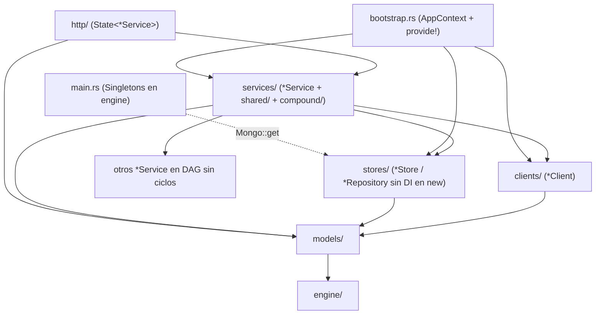
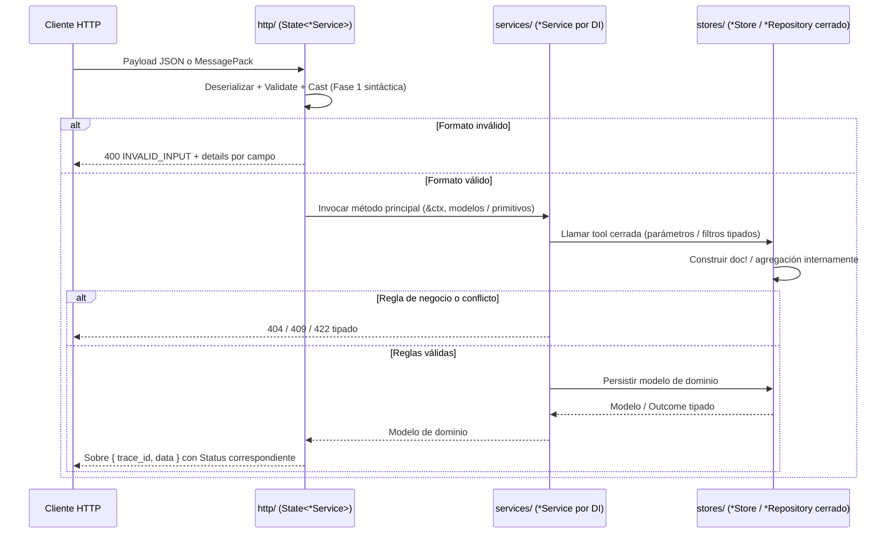

## 1. Infraestructura y Estructura

Mantendré el proyecto dividido en dos crates dentro del Virtual Workspace: `engine/` concentra el motor técnico reutilizable y permanecerá intacto durante el desarrollo de funcionalidades salvo solicitud explícita para extender el framework, mientras que `service/` aloja todo el código propio del microservicio. Los dominios `users`, `orders`, `checkout` y `carrier` presentes en `service/` actúan como implementaciones de referencia del molde arquitectónico y pueden sustituirse al iniciar un servicio nuevo respetando las mismas fronteras.

| Ruta o patrón              | Responsabilidad                                                                                                                                                                       | Límites e integración                                                                                                                                           |
| -------------------------- | ------------------------------------------------------------------------------------------------------------------------------------------------------------------------------------- | --------------------------------------------------------------------------------------------------------------------------------------------------------------- |
| `engine/src/runtime/`      | Gestionaré `engine::boot`, la carga tipada de entorno (`Envs`), singletons nombrados (`Registry<T>`) y telemetría (`Telemetry`, `as_json!`).                                          | No acoplaré variables ni nombres de instancias de un microservicio concreto dentro del motor.                                                                   |
| `engine/src/types/`        | Proveeré tipos universales libres de I/O y de BSON (`Cast<T, Db>`, `UtcDateTime`, `Context`, `Actor`, `DelegatedCredential`, `AppError`, `AppResult`).                                | Mantendré la traducción entre formato HTTP y formato de base de datos confinada a `with_db_mode` y `engine::db::BsonExt`.                                       |
| `engine/src/stores/`       | Expondré los singletons de infraestructura (`Mongo`, `MongoDb`, `Redis`, `Http`) activables por features (`mongo`, `redis`).                                                          | Confinaré `Collection`, `BsonExt`, `encode_entity`, `decode_entity` y `doc!` bajo `engine::db` para uso exclusivo de `service/src/stores/` [audit 12].          |
| `engine/src/web/`          | Gobernaré `ServerLauncher`, middlewares (`layers`), autenticación, RBAC, extractores validados, `engine::provide!` y el sobre uniforme (`response`).                                  | Impondré el formato de salida desde `ApiResponse`, `Status<T>`, `FileResponse` y `AppError` sin delegarlo a los controladores.                                  |
| `service/src/envs.rs`      | Declararé en `pub struct Env` el catálogo completo de variables de entorno del servicio implementando `FromEnv` y el acceso global `envs::get()`.                                     | Prohibiré leer variables con `env::var` fuera de `engine/src/runtime/env.rs` [audit 23].                                                                        |
| `service/src/main.rs`      | Invocaré `engine::boot(run())` inicializando `Envs::init::<Env>()`, `Telemetry::new(...)`, los singletons primarios (`Mongo::new`, `Redis::new`, `Http::new`) y `ServerLauncher`.     | Delegaré el ensamblaje por inyección de dependencias e índices a `bootstrap.rs` y el árbol de URLs a `routes.rs`.                                               |
| `service/src/bootstrap.rs` | Instanciaré almacenes/repositorios (`*Store::new()` / `*Repository::new()`) y clientes, verificaré índices y ensamblaré los `*Service` por DI en `AppContext`.                        | Expondré en `AppContext` (vía `engine::provide!`) únicamente instancias `*Service`, sin filtrar stores ni clientes hacia `http/`.                               |
| `service/src/routes.rs`    | Montaré en un único archivo los prefijos versionados de negocio (`/api/v1`) y los middlewares de reino (`Auth`, `require_header`), dejando `/healthz` y fallbacks a `ServerLauncher`. | Mantendré la lógica de cada recurso dentro de su módulo en `service/src/http/`.                                                                                 |
| `service/src/models/`      | Definiré los modelos de dominio, objetos de valor compartidos y sus invariantes en memoria.                                                                                           | No importaré `axum`, `engine::db`, `engine::stores`, `engine::web` ni ninguna capa superior [audit 5].                                                          |
| `service/src/stores/`      | Encapsularé cada unidad de persistencia (`*Store` o `*Repository`) como un subset cerrado resolviendo `Mongo::get(...)` sin DI y usando `Collection<Document>` del driver.            | Construiré todo `doc!` y helpers propios (`stores/helpers.rs`) adentro sin aceptar ni devolver jamás `Document`, `Bson` ni `Collection` en `pub` [audit 6, 24]. |
| `service/src/clients/`     | Implementaré adaptadores HTTP o SDKs hacia proveedores externos usando `HttpClient` y modelos de `models/`.                                                                           | Aislaré los payloads externos del proveedor dentro del cliente sin importar `stores`, `services`, `http` ni otros clientes [audit 7].                           |
| `service/src/services/`    | Concentraré la lógica de negocio y agregación en structs `*Service` (más tipos auxiliares o subcarpetas como `shared/` y `compound/`) recibiendo todo por DI.                         | No instanciaré `*Store`, `*Repository`, `*Client` ni `*Service` directamente dentro del servicio ni introduciré ciclos en el grafo [audit 8, 9, 10, 12].        |
| `service/src/http/`        | Declararé rutas, extractores, contratos HTTP (`*Request`, `*Resource`), `engine::respond!` y handlers que inyectan su `*Service` vía `State<*Service>`.                               | Invocaré únicamente las funciones principales del servicio inyectado sin tocar `stores/`, `clients/` ni primitivas de base de datos [audit 11, 12].             |

En `service/src/{models,stores,clients,services,http}/` modelaré cada dominio como un archivo plano por defecto, permitiendo estructuras auxiliares adicionales dentro de cada módulo de `stores/` y `services/`, así como subcarpetas organizativas (`services/shared/`, `services/compound/` o `<dominio>/mod.rs` cuando agrupe sub-flujos extensos):

```text
service/src/
├── main.rs                    # Bootstrap de singletons primarios y servidor
├── bootstrap.rs               # Ensamblaje DI de servicios + engine::provide!(AppContext => ...)
├── envs.rs                    # Estructura Env + envs::get()
├── routes.rs                  # Tabla global de rutas HTTP
├── models/
│   ├── mod.rs                 # Reexporta los modelos públicos
│   ├── shared.rs              # Objetos de valor transversales (Money, Currency, Country, Kilograms)
│   └── <singular>.rs          # Struct del modelo + constructores e invariantes
├── stores/                    # Condicional: solo para dominios con persistencia propia
│   ├── mod.rs                 # Reexporta *Store / *Repository y estructuras auxiliares
│   └── <dominio>.rs           # Struct *Store o *Repository (Mongo::get en new, sin DI) + structs auxiliares
├── clients/                   # Condicional: solo cuando existan proveedores externos
│   ├── mod.rs
│   └── <proveedor>.rs         # Struct *Client + contratos remotos privados
├── services/
│   ├── mod.rs                 # Reexporta *Service y comandos auxiliares
│   ├── <dominio>.rs           # Struct *Service (recibe dependencias por DI) + structs auxiliares
│   └── compound/ | shared/    # Opcional: servicios agregadores o utilidades de negocio compartidas
└── http/
    ├── mod.rs
    └── <dominio>.rs           # *Request, *Resource opcional, engine::respond! y routes() con State<*Service>
```

Para integrar un nuevo dominio con persistencia propia seguiré esta secuencia comprobable:

- [ ] Definir el modelo y sus invariantes en `service/src/models/<singular>.rs` y reexportarlo en `service/src/models/mod.rs`.
- [ ] Implementar `<Singular>Store` (o `<Singular>Repository`, con `new()` sobre `Mongo::get` sin DI, `col` privado e `init_indexes(&self)`) en `service/src/stores/<plural>.rs` y reexportarlo en `service/src/stores/mod.rs`.
- [ ] Implementar `<Singular>Service::new(...)` recibiendo sus stores/repositorios, servicios y clientes por DI en `service/src/services/<plural>.rs`, registrándolo e inicializando sus índices en `service/src/bootstrap.rs` (`AppContext` + `engine::provide!`).
- [ ] Crear `service/src/http/<plural>.rs` inyectando `State(<Singular>Service)`, declarando `*Request`, `engine::respond!` y `pub fn routes() -> Router<AppContext>`, anidándolo en `service/src/routes.rs`.
- [ ] Ejecutar la batería de verificación del workspace antes de cerrar el cambio.

Si el nuevo servicio es un agregador entre dominios existentes (como `CheckoutService` o un módulo bajo `service/src/services/compound/`), omitiré el archivo en `models/` y en `stores/` e inyectaré en su `new(...)` los servicios, stores o clientes requeridos desde `bootstrap.rs`.

## 2. Convenciones de Arquitectura, Archivos y Funciones

| Artefacto             | Patrón de ruta                                 | Símbolos y convenciones                                                                                                                                                                                        | Ejemplo verificado                                                      |
| --------------------- | ---------------------------------------------- | -------------------------------------------------------------------------------------------------------------------------------------------------------------------------------------------------------------- | ----------------------------------------------------------------------- |
| Modelo de dominio     | `service/src/models/<singular>.rs`             | `UpperCamelCase` en singular; alias de identidad (`pub type UserId = Cast<String, ObjectId>;`) y fechas con `UtcDateTime` inyectado al construir o mutar.                                                      | `User` (`UserId`), `Order` (`OrderId`)                                  |
| Almacén / Repositorio | `service/src/stores/<plural>.rs`               | Struct `<Singular>Store` o `<Singular>Repository` con `col: Collection<Document>` privado y `pub fn new() -> AppResult<Self>` sin DI; admite structs/enums auxiliares libres de BSON.                          | `UserStore::new()`, `UserFilter`, `UpdateOutcome<User>`                 |
| Cliente externo       | `service/src/clients/<proveedor>.rs`           | Struct `<Proveedor>Client` que recibe `Arc<HttpClient>`; payloads remotos privados al archivo.                                                                                                                 | `CarrierClient::new(client, url, api_key)`                              |
| Servicio de negocio   | `service/src/services/<dom>.rs` (o subcarpeta) | Struct `<Nombre>Service` `#[derive(Clone)]` con `pub fn new(...)` por DI (usando `<Nombre>ServiceDeps` cuando supere 7 dependencias) y métodos `pub async fn(&self, ctx: &Context, ...)`.                      | `UserService::new(store)`, `CheckoutService::new(...)`, `PlaceCheckout` |
| Contenedor DI         | `service/src/bootstrap.rs`                     | `pub struct AppContext` exponiendo únicamente `*Service` registrados mediante `engine::provide!(AppContext => ...)`.                                                                                           | `engine::provide!(AppContext => users: UserService, ...)`               |
| Entrada HTTP          | `service/src/http/<dominio>.rs`                | Structs `*Request` con `#[derive(Deserialize, Validate)]` extraídos mediante `ValidatedBody`, `ValidatedBodyWithRaw`, `ValidatedMultipart` (con feature `multipart`) o `ValidatedQuery`.                       | `CreateUserRequest`, `CheckoutRequest`                                  |
| Salida y estado HTTP  | `service/src/http/<dominio>.rs`                | `engine::respond!(Model => ModelResource);`, `engine::respond!(try Model => ModelResource);` o `engine::respond!(Model);`, devolviendo `AppResult<M>`, `AppResult<QueryResult<M>>` o `AppResult<Status<...>>`. | `User`, `OrderResource`, `QueryResult<User>`, `.created()`              |
| Controlador y rutas   | `service/src/http/<dominio>.rs`                | `pub fn routes() -> Router<AppContext>` con `{id}` vía `PathParam<Cast<...>>` e inyección `State(svc): State<*Service>` [audit 3, 11, 13].                                                                     | `.route("/{id}", get(get_user))`                                        |

Alinearé los nombres de métodos entre capas evitando repetir el sustantivo del módulo en `stores/` y `services/`, separando lecturas sin efectos secundarios de mutaciones:

| Operación          | `stores/<plural>.rs` (`&self`)         | `services/<plural>.rs` (`&self`) | `http/<plural>.rs` (handler privado) | Ruta y método HTTP     |
| ------------------ | -------------------------------------- | -------------------------------- | ------------------------------------ | ---------------------- |
| Alta de recurso    | `insert(&user)`                        | `create(&ctx, ...)`              | `create_<singular>`                  | `POST /` (`201`)       |
| Lectura puntual    | `find_active(id)` -> `Option<M>`       | `find_active(&ctx, id)`          | `get_<singular>`                     | `GET /{id}` (`200`)    |
| Listado paginado   | `list_active(&filter, skip, limit)`    | `list(&ctx, ...)`                | `list_<plural>`                      | `GET /` (`200`)        |
| Predicado booleano | `email_exists(email)` -> `bool`        | —                                | —                                    | —                      |
| Actualización      | `update_versioned(&user)` -> `Outcome` | `update(&ctx, ...)`              | `update_<singular>`                  | `PUT /{id}` (`200`)    |
| Borrado (lógico)   | `soft_delete(id, now)` -> `bool`       | `delete(&ctx, id)`               | `delete_<singular>`                  | `DELETE /{id}` (`204`) |

- Mantendré un orden interno consistente de arriba hacia abajo en cada archivo: en `models/`, enums/tipos auxiliares seguidos del struct principal y sus constructores/mutadores; en `stores/`, structs/enums auxiliares tipados, el struct `*Store` / `*Repository`, `new()`, `init_indexes(&self)`, lecturas y escrituras; en `services/`, structs auxiliares, el struct `*Service`, `new(...)`, métodos públicos de negocio y helpers privados; y en `http/`, contratos `*Request`, proyecciones `*Resource` + `engine::respond!`, `pub fn routes()` y handlers privados.
- Mantendré en cada función asíncrona de `stores/`, `clients/`, `services/` y handlers de `http/` el atributo `#[tracing::instrument(skip_all)]` (agregando únicamente identificadores seguros en `fields(...)` cuando aporten trazabilidad) para no volcar payloads ni credenciales en los spans [audit 16].
- Declararé todos los `use crate::...` y `use engine::...` en la cabecera del archivo o módulo, evitando rutas totalmente calificadas en línea dentro de cuerpos de funciones [audit 14].
- Usaré las features de `engine` en `service/Cargo.toml` según la infraestructura real del servicio (`mongo` y `redis` activas por defecto; `uuid` disponible para `Cast<String, Uuid>` o `Cast<Uuid>` con `new_v7()`, `multipart` disponible para `ValidatedMultipart` sobre `axum_typed_multipart` agregando `axum` y `axum_typed_multipart` en `service/Cargo.toml` si se usa el derive, y `default-features = false` cuando el servicio opere sobre SQL sin MongoDB ni Redis).

## 3. Ejemplos de Escritura e Integración

En `service/src/stores/` resolveré el singleton `Mongo::get(Mongo::DEFAULT)?` dentro de `new()` sin inyección de dependencias, manteniendo privada la `Collection<Document>` nativa del driver y encapsulando los helpers propios del servicio en `stores/helpers.rs`:

```rust
#[derive(Clone)]
pub struct UserStore {
    col: Collection<Document>,
}

impl UserStore {
    pub fn new() -> AppResult<Self> {
        let db = Mongo::get(Mongo::DEFAULT)?;
        Ok(Self { col: primary_collection(&db, "users") })
    }
}
```

En `service/src/services/` recibiré stores/repositorios, otros servicios y clientes por inyección de dependencias en `new(...)`, registrando saltos de contexto con `.trace(...)` o `.trace_here()`:

```rust
impl CheckoutService {
    pub fn new(users: UserService, orders: OrderService, carrier: Option<CarrierClient>) -> Self {
        Self { users, orders, carrier }
    }

    #[tracing::instrument(skip_all, fields(user_id = %cmd.user_id))]
    pub async fn execute(&self, ctx: &Context, cmd: PlaceCheckout) -> AppResult<Order> {
        let user = self.users.find_active(ctx, &cmd.user_id).await.trace("verificando usuario")?;
        self.orders.place(ctx, user.id, cmd.idempotency_key, cmd.items).await.trace("creando orden")
    }
}
```

En `service/src/bootstrap.rs` instanciaré stores y clientes, cruzaré las dependencias de los servicios y publicaré cada `*Service` para extracción HTTP con `engine::provide!`:

```rust
engine::provide!(AppContext => users: UserService, orders: OrderService, checkout: CheckoutService);

let user_store = UserStore::new()?;
let order_store = OrderStore::new()?;
tokio::try_join!(user_store.init_indexes(), order_store.init_indexes())?;
let users = UserService::new(user_store);
let orders = OrderService::new(order_store);
let checkout = CheckoutService::new(users.clone(), orders.clone(), carrier);
```

En `service/src/http/` inyectaré el `*Service` correspondiente mediante `State<*Service>`, conectando la entidad directo con `engine::respond!(User);` (o proyectando con `Order => OrderResource` solo cuando deba ocultarse o transformarse algún campo):

```rust
engine::respond!(User);

#[tracing::instrument(skip_all)]
async fn create_user(
    ctx: Context,
    State(users): State<UserService>,
    ValidatedBody(req): ValidatedBody<CreateUserRequest>,
) -> AppResult<Status<User>> {
    users.create(&ctx, req.name, req.email).await.created() // o .status(StatusCode::CREATED) / .status(201)
}
```

En pruebas de integración aislaré la instancia `"default"` por tarea asíncrona con `Mongo::scope` para que `Store::new()` conecte contra la base efímera de cada test en paralelo:

```rust
let db = MongoDb::connect_for_tests().await;
Mongo::scope(Mongo::DEFAULT, db.clone(), async {
    let store = UserStore::new().expect("user store");
    store.init_indexes().await.expect("indexes");
    let svc = UserService::new(store);
}).await;
db.drop_for_tests().await;
```

## 4. Reglas Generales

Respetaré en todo momento la dirección estricta de dependencias e inyección entre crates y carpetas del microservicio:



| Origen en `service/src/` | Dependencias permitidas                                                                                       | Dependencias y prácticas prohibidas                                                                                                                               |
| ------------------------ | ------------------------------------------------------------------------------------------------------------- | ----------------------------------------------------------------------------------------------------------------------------------------------------------------- |
| `models/`                | `engine` (solo tipos puros: `Cast`, `UtcDateTime`, `AppError`, `AppResult`), `serde`                          | `stores/`, `clients/`, `services/`, `http/`, `bootstrap`, `routes`, `engine::db`, `engine::stores`, `engine::web` [audit 5]                                       |
| `stores/<dom>.rs`        | `crate::models::*`, `engine::db` (`Collection`, `BsonExt`, `encode_entity`, `decode_entity`, `doc!`), `Mongo` | `services/`, `http/`, `clients/`, `engine::web`, otros hermanos en `stores/`, o exponer `Document`/`Bson`/`Collection` en `pub` [audit 6, 24]                     |
| `clients/<prov>.rs`      | `crate::models::*`, `engine` (`HttpClient`, `AppError`, `AppResult`)                                          | `stores/`, `services/`, `http/`, `engine::db`, `engine::stores`, `engine::web`, otros hermanos en `clients/` [audit 7]                                            |
| `services/**`            | `crate::models::*`, `crate::stores::*`, `crate::clients::*`, otros `services::*` en DAG (DI)                  | `http/`, `bootstrap`, `routes`, `engine::web`, `engine::db`, `Document`/`Bson`/`doc!`, `*Dto`, `*(Store\|Repository\|Client\|Service)::new(` [audit 8, 9, 10, 12] |
| `http/<dom>.rs`          | `crate::services::*`, `crate::models::*`, `crate::bootstrap::AppContext`, `engine::web`                       | `crate::stores::*`, `crate::clients::*`, `Mongo::`, `engine::db`, `Document`/`doc!`, o instanciar `*Service::new(` [audit 11, 12]                                 |

Separaré la validación y ejecución en responsabilidades estrictas entre `http/`, `services/` y `stores/`:



- Nunca construiré ni recibiré `Document`, `Bson` ni fórmulas dinámicas fuera de `service/src/stores/`; cuando un servicio requiera filtrar, paginar, proyectar campos ligeros o agregar lotes, definirá o consumirá un struct/enum auxiliar tipado en Rust y el método del `*Store` / `*Repository` traducirá internamente esos parámetros a BSON [audit 12, 24].
- Cuando un dominio crezca en sub-flujos extensos, lo expandiré a `<dominio>/mod.rs` con submódulos internos cohesivos en `models/`, `stores/`, `services/` o `http/`; en `services/`, los submódulos bajo `services/<dominio>/**` pertenecen al mismo nodo del grafo, mientras que `services/shared/<unidad>` y `services/compound/<unidad>` operan como nodos independientes sujetos al DAG sin ciclos [audit 10].
- Cuando el microservicio exponga múltiples reinos HTTP sobre los mismos servicios (ej. consola `/api/v1/ui`, ingesta M2M `/api/v1/xb`, API Keys `/api/v1/b2b` y tareas `/api/v1/worker`), registraré cada proveedor en `Auth::register("nombre", ...)` (`JwtJwksAuthProvider` o `TokenAuthProvider::new(...)` / `static_secret(...)` para evaluadores propios de token) y envolveré cada reino en `service/src/routes.rs` con `.with_jwt_auth(...)`, `.with_relay_auth(...)`, `.with_header_auth("x-api-key", ...)` o `.with_task_auth(...)` junto con `.require_header::<T>(...)`, manteniendo todos los sub-routers tipados sobre `Router<AppContext>`.
- Coordinaré lecturas cacheadas e invalidaciones mediante `Redis::remember` y `Redis::invalidate` (que operan como no-op seguro cuando Redis no está configurado), evitando crear structs adaptadores repetitivos por cada caché de catálogo.
- Respetaré el sobre uniforme delimitado por `engine` (negociado automáticamente en JSON o MessagePack): `{ trace_id, data }` en respuestas con carga (incluyendo paginados `{ items, total }` en `QueryResult<T>`), `{ trace_id }` en respuestas sin carga distintas de `204`/`304` (`Status::code(202)`), cuerpo vacío en `204 No Content` / `304 Not Modified`, `FileResponse` para descargas binarias directas, y `{ trace_id, code, cause, details? }` en errores.
- Mantendré la higiene de errores en dos capas dentro de `AppError`: `cause` y `details` contendrán únicamente información segura y accionable para el consumidor externo, mientras que los errores crudos de drivers, consultas o proveedores viajarán exclusivamente en `.with_internal(...)` o constructores `internal`/`database`/`censored`, usando `AppError::status(code, msg)` para cualquier código HTTP puntual (`429`, `503`...) e inspeccionando saltos con `err.log_now()` o `err.trace_report()` cuando se requiera diagnóstico manual.
- Prohibiré en código fuera de `#[cfg(test)]` el uso de `.unwrap()`, `.expect()`, `panic!`, indexación directa `v[i]`, conversiones con `as` y aritmética sin comprobar; utilizaré propagación con `?`, `From`/`TryFrom` y métodos `checked_*` o `saturating_*` exigidos por `[workspace.lints.clippy]` y el check 1 de `audit.sh`.
- No emplearé `serde_json::Value`, `serde_json::Map` ni `json!` fuera de eventos de logging, `service/src/clients/` o contratos crudos explícitos en `service/src/http/` [audit 19, 20].
- Ejecutaré como compuerta obligatoria tras cualquier cambio en código:
  1. `cargo fmt --all --check` para verificar formato.
  2. `bash scripts/audit.sh` para comprobar los 24 checks duros de arquitectura (y revisar las salidas informativas `[insp]`).
  3. `cargo clippy --workspace --all-targets -- -D warnings` (y `--no-default-features` / `--all-features` sobre `-p engine` si se tocó `engine/`).
  4. `cargo test --workspace` para pruebas unitarias y HTTP en memoria, ejecutando además `MONGO_TEST_URL=<uri> cargo test -p service -- --ignored` cuando deba validarse integración real contra MongoDB y `cargo deny check advisories bans sources` cuando se alteren dependencias.

## 5. Reglas Particulares del Proyecto

- Representaré importes monetarios exclusivamente en unidades menores enteras mediante `Money` y `Currency`, y encapsularé magnitudes físicas continuas dentro de objetos de valor validados en `service/src/models/shared.rs` (como `Kilograms` con redondeo determinista), prohibiendo el uso crudo de `f32` o `f64` en `stores/`, `services/` y `http/` [audit 18].
- Pasaré `UtcDateTime::now()` desde el servicio hacia los constructores y mutadores del modelo (`User::new(..., now)`, `user.update_profile(..., now)`) en lugar de leer el reloj del sistema dentro de `models/`, garantizando determinismo en pruebas unitarias.
- No lanzaré tareas desprendidas con `tokio::spawn` dentro de `models/`, `stores/`, `services/`, `http/` ni `clients/`, dado que Cloud Run restringe la CPU al finalizar la respuesta HTTP; ejecutaré el trabajo en línea o delegaré procesos diferidos a colas externas hacia endpoints worker autenticados con `.with_task_auth(...)` [audit 17].
- Conservaré la sonda `GET /healthz` (`engine::web::health_router()`) libre de consultas a bases de datos o servicios externos para que solo responda `200 OK` en operación y `503 Service Unavailable` durante el drenaje de apagado, evitando reinicios en cascada ante intermitencias de red.
- Cuando dos métodos HTTP sobre la misma ruta requieran permisos RBAC distintos con `RequirePermissionExt`, declararé cada verbo en su propio `Router` y los uniré con `.merge(...)` para que el `route_layer` de un verbo no envuelva al otro.
- No aplicaré `TimeoutLayer` de `tower-http` (que rompe el sobre de respuesta) ni llamaré `.timeout(...)` por petición dentro de `service/src/clients/`; cuando un proveedor externo requiera un presupuesto distinto a los 10 segundos por defecto, registraré una instancia dedicada con `Http::with_timeout(&env.service_name, duracion, "nombre_instancia")` en el arranque [audit 4, 22].
- Diseñaré los índices compuestos en `stores/<dominio>.rs::init_indexes(&self)` siguiendo la regla ESR (Igualdad -> Ordenamiento -> Rango) con nombre explícito e inmutable: nunca cambiaré las llaves de un índice existente conservando el mismo nombre (error `IndexKeySpecsConflict`, código 86 en MongoDB) ni renombraré un índice existente con las mismas llaves (error `IndexOptionsConflict`, código 85), y mantendré aditivos los enums persistidos en documentos históricos.
- Nunca usaré borrado físico (`delete_one`, `delete_many`, `delete_by_id`) sobre modelos que declaren borrado lógico con `deleted_at: Option<UtcDateTime>`; emplearé siempre borrado lógico y filtraré activos con `"deleted_at": null` (que en MongoDB coincide tanto con `null` como con documentos que omitan el campo).
- Escaparé cualquier texto de entrada del usuario destinado a búsquedas parciales en MongoDB mediante `engine::db::escape_regex` dentro de `stores/` antes de construir expresiones `$regex`.
